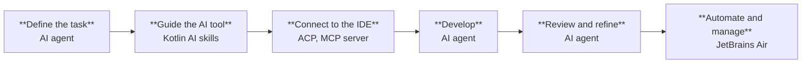

[//]: # (title: AI tools for Kotlin development)
[//]: # (description: Boost your Kotlin development with AI and learn how to use AI Assistant, Junie, JetBrains Air, Kotlin AI skills, coding agents, and IDE integrations to write, test, review, and refactor code.)

AI-powered tools can assist with many Kotlin development tasks. They can generate and explain code, implement
features, create tests, review changes, refactor existing code, and automate recurring development tasks.

The Kotlin ecosystem includes tools for interactive development, AI agents, and large-scale agent orchestration.
Depending on your workflow, you can:

* : Use AI features directly in IDEs such as IntelliJ IDEA and Android Studio.
* [Work with AI agents](#use-ai-agents): Choose an AI agent such as Junie or a third-party agent and improve its Kotlin expertise
with Kotlin AI skills.
* [Manage and scale AI development](#manage-ai-agents): Coordinate interactive and automated agent workflows.

This page explains the differences between the tools and how they can benefit you at different stages of the workflow.

## Develop in the IDE

IDEs can offer AI-powered features directly in your development environment. You can write, modify, and review
Kotlin code without leaving the IDE.

### AI Assistant

[AI Assistant](https://plugins.jetbrains.com/plugin/22282-jetbrains-ai-assistant) provides AI-powered assistance 
directly in JetBrains IDEs, such as in [IntelliJ IDEA](https://www.jetbrains.com/idea/download/), as well as in [Android Studio](https://developer.android.com/studio).
You can use it for interactive development tasks where you want to stay in control of each change.

The AI assistant provides:

* Access to AI agents, including [Junie](https://www.jetbrains.com/junie/), Claude Code, OpenAI Codex, and any third-party agents that support 
the Agent Client Protocol.
* Context-aware AI chat using cloud-hosted models, such as Gemini, GPT, and Claude, as well as your own local models.
* AI-assisted code completion and next edit suggestions.

Learn more about [AI assistant integration with JetBrains IDEs](https://www.jetbrains.com/help/ai-assistant/about-ai-assistant.html).

### JetBrains Air in IDEs

[JetBrains Air in IDEs](https://www.jetbrains.com/air/ides/) is a plugin that provides an environment in JetBrains IDEs
for working with coding agents. Use it to start agent sessions across projects, follow their progress, and review changes
with IDE features such as code navigation and inspections. You can comment on a diff and ask an agent to revise its work.

Air allows you to connect compatible agents installed locally on your machine or choose agents from the [ACP registry](https://agentclientprotocol.com/get-started/registry).
You can also run tasks locally or delegate longer tasks to cloud agents through [Air Teams](https://air.jetbrains.cloud/).

Learn more about [Air in JetBrains IDEs](https://www.jetbrains.com/air/ides/).

## Use AI agents

AI agents can perform development tasks with less direct guidance than interactive AI assistants. For example, they
can explore a project, plan implementation steps, modify multiple files, or run commands and tests.

> If you're not sure which AI agent to use, check the [Kotlin Benchmark](https://kotlinlang.org/benchmark/) to compare how different agents perform on Kotlin
> development tasks.
> 
{style="tip"}

### Air Gateway

[Air Gateway](https://www.jetbrains.com/air/gateway/) is a command-line tool for running terminal agents, such as Claude Code, Codex,
and Junie CLI, through a JetBrains account using JetBrains AI credits. Your agent keeps its existing terminal workflow,
while access to agents and models can be managed centrally through JetBrains Console.

Learn more about [Air Gateway](https://www.jetbrains.com/air/gateway/).

### Air Context

[Air Context](https://www.jetbrains.com/air/context/) is a codebase indexing service with a command-line interface that builds a semantic 
index of repositories so coding agents can find relevant code, APIs, dependencies, tests, and implementation patterns.

Use Air Context when agents need to explore a large codebase or find existing implementations and project conventions. It integrates
with supported agents, including Claude Code, Codex CLI, and Junie CLI, and can be used from IDEs and other supported editors.

Learn more about [Air Context](https://www.jetbrains.com/air/context/).

### Junie

[Junie](https://junie.jetbrains.com/) is a JetBrains AI agent. You can use Junie [in JetBrains IDEs and Android Studio](https://plugins.jetbrains.com/plugin/26104-junie-the-ai-coding-agent-by-jetbrains),
[from your terminal](https://junie.jetbrains.com/docs/junie-cli.html), or [in headless mode](https://junie.jetbrains.com/docs/junie-headless.html) in CI/CD pipelines.
You can also integrate Junie into your [GitHub workflows](https://junie.jetbrains.com/docs/junie-on-github.html).

Junie is designed for tasks that require more than a single code suggestion or chat response. Use Junie for development
tasks that involve multiple files or require planning and execution. You can ask it to implement a feature, update code
across multiple files, add tests, or perform maintenance work.

When Junie runs in an IDE, it can also use IDE capabilities such as project indexing, code navigation, inspections,
refactorings, debugging, and framework-aware project analysis.

Learn more about [Junie](https://junie.jetbrains.com/docs/get-started-with-junie.html).

### Third-party AI agents

Many third-party AI development tools support Kotlin. They are available as IDE extensions, standalone editors, command-line tools,
and cloud-based development environments. For example:

* GitHub Copilot
* Google Gemini
* Claude Code
* OpenAI Codex

Choose a third-party tool if it matches your preferred development environment or offers capabilities that fit your workflow.
Many of these tools support Kotlin code generation, explanations, test creation, and refactoring.

You can use third-party tools independently or connect compatible agents to JetBrains IDEs through [ACP](#agent-client-protocol).

### MCP servers

The Model Context Protocol (MCP) connects AI models to external data sources, tools, and systems.
JetBrains maintains several MCP servers that can make your Kotlin experience more productive:

* The [JetBrains IDE MCP server](https://plugins.jetbrains.com/plugin/26071-mcp-server) exposes IDE capabilities.
  Using the server, an AI agent can use IDE features such as project indexing, code navigation, refactoring, inspections, and build execution.
  This gives the agent a better understanding of your Kotlin project as well as more efficient means of generating and evaluating code.
* The [MCP Kotlin SDK](kotlin-ai-apps-development-overview.md#model-context-protocol-mcp-kotlin-sdk) is a Kotlin Multiplatform implementation. It helps you build AI-powered applications in Kotlin
  and integrate with LLM surfaces across the JVM, WebAssembly, and iOS.
* For Kotlin Multiplatform projects, the [klibs.io MCP server](https://github.com/JetBrains/klibs-io/blob/master/integrations/mcp/README.md)
  helps agents access the catalog of available multiplatform libraries to more efficiently look for existing solutions.
* For Compose Multiplatform projects, the [Compose Hot Reload MCP server](https://kotlinlang.org/docs/multiplatform/compose-hot-reload.html#mcp-server-for-ai-agents)
  allows agents to directly interact with the reloadable app: trigger reloads, take screenshots, read semantic trees, and so on.

### Kotlin AI skills

Kotlin AI skills are reusable instructions that guide an AI agent through Kotlin development tasks. They help agents perform
these tasks more consistently.

Use Kotlin AI skills when you want to guide an agent toward idiomatic Kotlin patterns, Kotlin coding conventions,
and project-specific expectations. Skills help AI agents perform tasks such as writing Kotlin code, explaining language
features, generating documentation, creating tests, reviewing code, or applying migration guidance.

Kotlin AI skills can be used with different agents and workflows, including IDE-based agents,
command-line agents, and external AI tools that support reusable instructions.

Learn more about .

### Kotlin-specific acceptance criteria

Kotlin Multiplatform projects in particular are complex enough for agents to lose track of the entire project structure
and consequences of specific changes.

To help the agent, you can include the following examples as your general ([AGENTS.md](https://agents.md/))
or task-specific success criteria:

* Run target-specific tests after introducing changes whenever such tests are available. 
* Verify that all configured KMP targets successfully build before considering a task complete. 
* Review the implementation for platform-specific APIs leaking into common code
  to avoid agents (or developers) accidentally using these APIs in common code later on.

## Manage AI agents

Development teams may need multiple AI agents to automate recurring tasks, monitor agent activity, or evaluate different
tools before deciding to adopt them. The following tools support AI-assisted development beyond individual coding sessions.

### JetBrains Air Teams

[JetBrains Air Teams](https://www.jetbrains.com/air/) lets teams collaborate on agent tasks in shared projects and dedicated cloud environments.
Teams can configure machine resources, network access, variables, and secrets for each project, and connect MCP servers 
so team members and agents can use the same external tools.

Use Air Teams when your project needs shared agent environments and sessions for collaboration and review.

Learn more about [Air Teams](https://www.jetbrains.com/air/) or [access Air Teams](https://air.jetbrains.cloud/).

### JetBrains Air Governance

[JetBrains Air Governance](https://www.jetbrains.com/air/governance/) provides organization-level controls for AI-assisted and agent-driven development. 
Administrators can control which agents, models, and MCP servers developers can use, and set AI credit limits. Policies can apply across the
organization or be tailored to specific teams or individuals. Usage analytics help you understand which tools teams use and where to invest.

Use Air Governance when your organization needs to manage access and costs across different AI tools and providers. You
can use JetBrains AI or supply your organization's provider API keys while managing usage centrally.

Learn more about [Air Governance](https://www.jetbrains.com/air/governance/).
